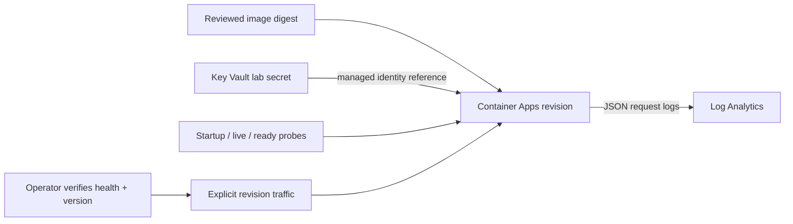

# Azure Service Operations Lab

A small .NET service for inspecting the parts of a deployment that a successful
build cannot verify: secret delivery, readiness, request logs and revision rollback.

**Current boundary:** the API and verification harness run locally and in CI.
The Azure templates and runbook are provided for a future deployment. No Azure
subscription or live cloud endpoint has been used for this preview.

## Run locally

Requires the .NET 10 SDK and Python 3.10+. No external NuGet packages or cloud credentials.

```sh
dotnet run --project tests/Verify -c Release
dotnet publish src/Api -c Release -o artifacts/api --no-self-contained
python scripts/http_check.py --dll artifacts/api/Api.dll
```

The HTTP harness starts disposable loopback processes. It checks healthy and
unready configurations, actual cooperative timeouts, recovery and JSON logs.
It never sends data to Azure. The `LAB_DEPENDENCY_TOKEN` used by the harness is
a synthetic sentinel; the service checks its presence without returning it.

To inspect the API yourself in PowerShell:

```powershell
$env:LAB_DEPENDENCY_TOKEN = 'synthetic-local-value'
$env:ASPNETCORE_URLS = 'http://127.0.0.1:5088'
dotnet run --project src/Api -c Release
```

Open `/version`, `/health/live`, `/health/ready`, `/api/reference`, or
`/api/reference?delayMs=1000`. The final request should return 504. Stop with Ctrl+C.

## Deployment shape



1. [Foundation](infra/foundation.bicep): consumption environment, capped log
   workspace, user-assigned identity and Key Vault secret-reader role.
2. [Application](infra/application.bicep): HTTPS ingress, Key Vault reference,
   probes and at most one replica per revision. Initial deployment only.
3. [Deployment and rollback runbook](docs/AZURE-RUNBOOK.md): account/cost gates,
   exact image identity, candidate validation and explicit traffic readback.
4. [Monitoring queries](docs/monitoring.kql): request errors and duration by
   revision, plus platform logs. No invented latency or reliability targets.

## Decisions worth reviewing

- A read budget covers waiting for a slot as well as execution. Cancellation is
  cooperative. If work ignores it, that work keeps its slot until it finishes;
  the code does not claim that timed-out work has stopped.
- A live process can be unready. Readiness checks the synthetic required setting;
  it does not prove that a real downstream service is reachable.
- No retries on writes: this API has no payment, order or other write endpoint.
- The app logs route categories, status, duration and a generated correlation ID.
  It does not log token values, query strings or arbitrary caller-supplied paths.
- Traffic rollback restores a selected application revision. It does not restore
  data or undo app-wide secret/configuration changes.

## Scope and attribution

Independent synthetic portfolio sample, developed with AI assistance and reviewed
through explicit tests. No employer source or data. In-process concurrency limits
are per replica; this is not a distributed admission protocol or production trading
service. Templates compiling and CI passing do not establish practical Azure
operations experience. See [evidence requirements](docs/EVIDENCE.md) and
[release notes](CHANGELOG.md).
